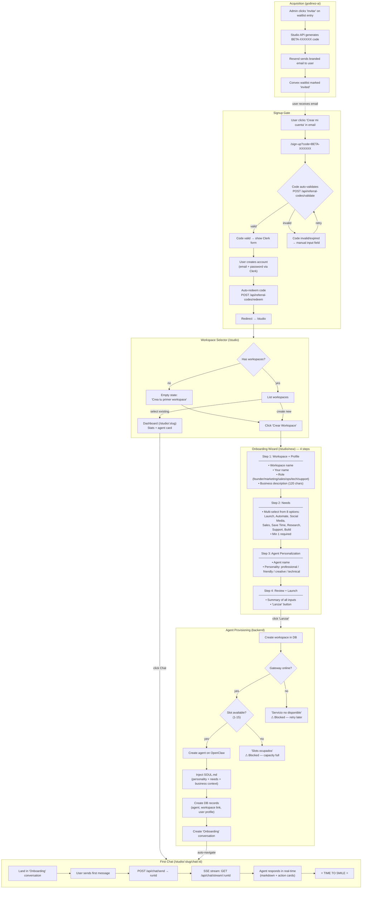

# Onboarding Flow — Godinez Studio Beta

## Full Funnel: Email → First Agent Response



## User Input Summary

| Step | Inputs | Required | Type |
|------|--------|----------|------|
| Referral code | `code` | Yes | Text (auto-uppercase) |
| Clerk signup | Email, password | Yes | Clerk-managed |
| Workspace + profile | Workspace name, your name, role, business description | All required | Text + single-select |
| Needs | 1-8 needs from preset list | Min 1 | Multi-select |
| Agent | Agent name, personality | Name required | Text + single-select |

## Error States & Recovery

| Where | Error | User Sees | Recovery |
|-------|-------|-----------|----------|
| Code gate | Invalid/expired code | "Codigo invalido o expirado" | Enter different code |
| Code gate | No code provided | "Ingresa un codigo de invitacion" | Enter code |
| Wizard Step 1 | Missing fields | Next button disabled (no message) | Fill all fields |
| Wizard Step 2 | No needs selected | "Debes seleccionar al menos una opcion" | Select at least 1 |
| Provisioning | Gateway offline | "El servicio de agentes no esta disponible" | Wait + retry |
| Provisioning | All 15 slots full | "Todos los slots estan ocupados" | Wait + retry |
| Provisioning | Generic error | "Hubo un error al provisionar el agente" | Retry button |
| Chat | Agent silent | Spinner stays | Refresh or new conversation |

## Time-to-Smile Breakdown

```
Email received                    0:00
├─ Click link in email            0:05   (user action)
├─ Code auto-validates            0:07   (~2s API call)
├─ Fill Clerk signup form         1:00   (email + password + verify)
├─ Redirected to /studio          1:05
├─ Click "Crear Workspace"        1:10
├─ Fill Step 1 (4 fields)         2:00   (name, role, description)
├─ Select needs (Step 2)          2:20   (quick multi-select)
├─ Name agent + personality       2:40   (Step 3)
├─ Review + click Launch          2:50   (Step 4)
├─ Provisioning completes         3:00   (~10s backend)
├─ Type first message             3:15
└─ Agent responds                 3:25   ⭐ SMILE
                                  ─────
                          Total: ~3.5 min
```

## UX Improvement Opportunities

### High Impact (reduce drop-off)
1. **Merge code gate + Clerk signup** — show code field inside or above the Clerk form to reduce perceived steps
2. **Auto-navigate past WorkspaceSelector** — new users (0 workspaces) should go straight to the wizard
3. **Inline field validation on Step 1** — show red outlines on blur, not just disable Next
4. **Progress indicator during provisioning** — "Creando workspace... Configurando agente... Listo!" instead of plain spinner

### Medium Impact (reduce confusion)
5. **Add "start chatting" CTA on Dashboard** — users who land on Dashboard don't see a clear next action
6. **Pre-fill agent name** — default to something like "Mi Agente" to reduce friction on Step 3
7. **Wizard step indicator** — show "Paso 1 de 4" progress bar
8. **Handle capacity-full gracefully** — show estimated wait time or waitlist position

### Low Impact (polish)
9. **"Contact support" link on code gate errors** — currently a dead end if code doesn't work
10. **Onboarding conversation should have a welcome message** — currently empty, user must initiate
11. **Detect incomplete workspaces** — if user closed browser mid-provision, redirect back to wizard instead of showing broken dashboard
