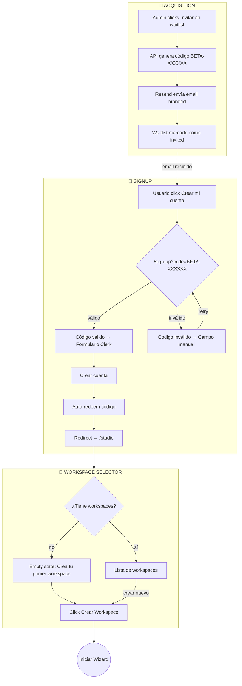
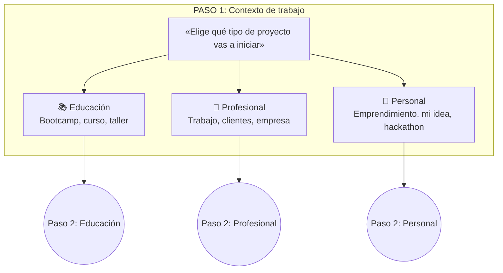
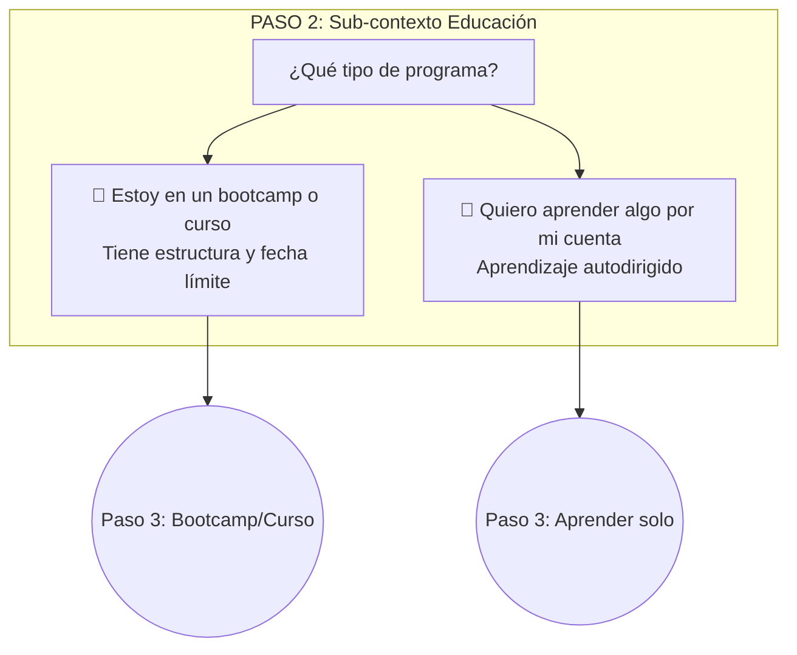
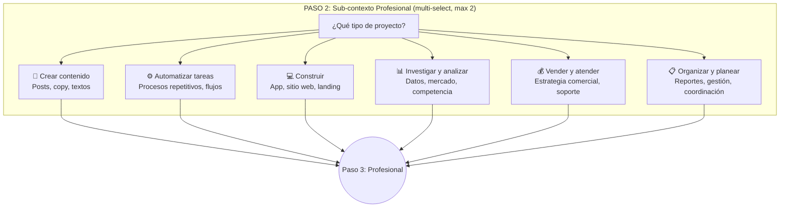
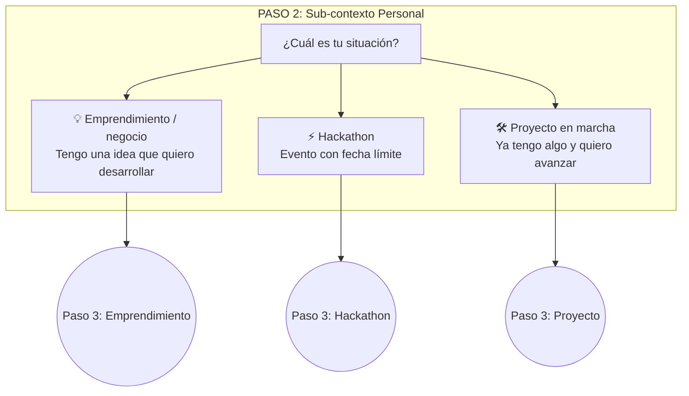
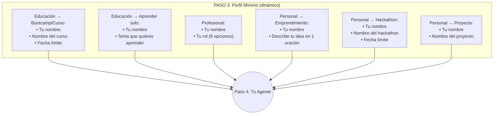
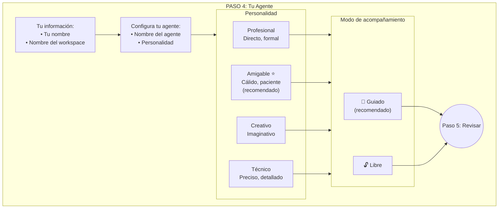
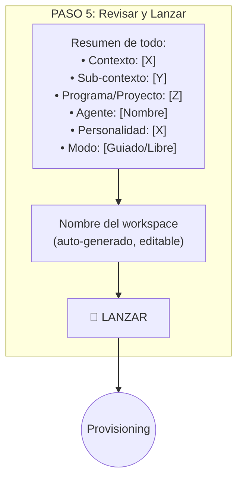
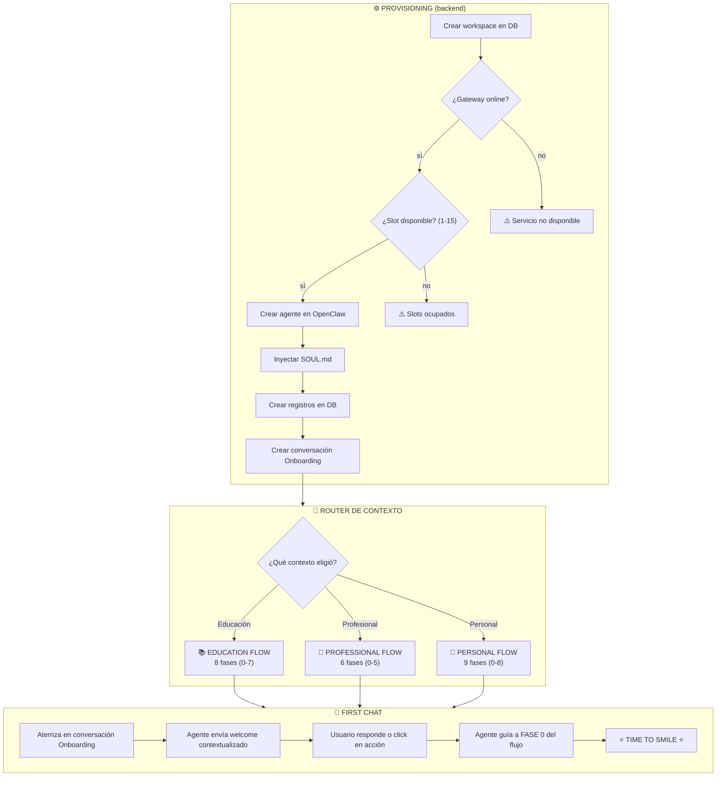
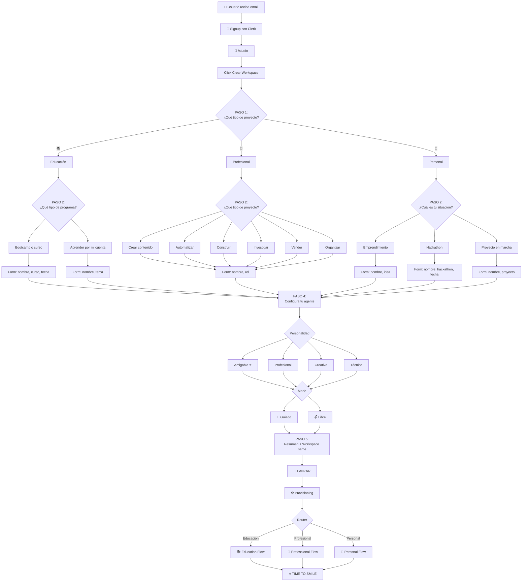

# GODINEZ AI — Onboarding Flow Integrado
## Del Email a la Primera Victoria
### Flujo Dinámico por Contexto — Marzo 2026

---

## 1. Resumen ejecutivo

Este documento presenta el flujo completo de onboarding de Godinez AI, desde que el usuario recibe el email de invitación hasta que logra su primera victoria con el agente.

### 1.1 Problema identificado

El flujo anterior del wizard presentaba las siguientes fricciones:
- **Orden incorrecto de preguntas:** Se pedía nombre del workspace y datos de perfil antes de entender qué quiere hacer el usuario.
- **Falta de segmentación por contexto:** No distinguía entre usuarios de educación, profesionales o personales.
- **Opciones de necesidades confusas:** 8 opciones que mezclaban acciones con áreas.
- **Campos innecesarios al inicio:** Se pedía información que no es crítica para el primer uso.

### 1.2 Solución propuesta

Un flujo de **5 pasos** basado en el principio de **intención primero**:
1. Entender qué quiere hacer el usuario (mediante selección de cards)
2. Pedir solo los datos mínimos necesarios
3. Configurar el agente con la personalidad adecuada
4. Elegir el modo de acompañamiento (guiado/libre)
5. Completar el perfil de forma conversacional después del lanzamiento

---

## 2. Flujo Pre-Wizard

---

## 3. Wizard Paso 1: Contexto de Trabajo

---

## 4. Wizard Paso 2: Sub-contexto (3 caminos separados)

### Camino A: Si eligió Educación

### Camino B: Si eligió Profesional

### Camino C: Si eligió Personal

---

## 5. Wizard Paso 3: Perfil Mínimo (6 formularios diferentes)

---

## 6. Wizard Paso 4: Tu Agente

---

## 7. Wizard Paso 5: Revisar y Lanzar

---

## 8. Provisioning y Router

---

## 9. Flujo Completo Unificado

---

## 10. Detalle de cada Paso

### PASO 1 — Contexto de trabajo

**Pregunta:** «Elige qué tipo de proyecto vas a iniciar»

| Icono | Opción | Subtexto |
|-------|--------|----------|
| 📚 | **Educación** | Bootcamp, curso, taller |
| 💼 | **Profesional** | Trabajo, clientes, empresa |
| 🚀 | **Personal** | Emprendimiento, mi idea, hackathon |

---

### PASO 2 — Sub-contexto (dinámico)

#### Si eligió 📚 Educación:

| Opción | Descripción |
|--------|-------------|
| 🎯 Estoy en un bootcamp o curso | Tiene estructura y fecha límite |
| 🧭 Quiero aprender algo por mi cuenta | Aprendizaje autodirigido |

#### Si eligió 💼 Profesional (multi-select, max 2):

| Opción | Ejemplo |
|--------|---------|
| 📝 Crear contenido | Posts, copy, textos |
| ⚙️ Automatizar tareas | Procesos repetitivos |
| 💻 Construir | App, sitio web, landing |
| 📊 Investigar y analizar | Datos, mercado |
| 💰 Vender y atender | Estrategia comercial |
| 📋 Organizar y planear | Reportes, gestión |

#### Si eligió 🚀 Personal:

| Opción | Descripción |
|--------|-------------|
| 💡 Emprendimiento / negocio | Tengo una idea que quiero desarrollar |
| ⚡ Hackathon | Evento con fecha límite |
| 🛠️ Proyecto en marcha | Ya tengo algo y quiero avanzar |

---

### PASO 3 — Perfil mínimo (6 formularios)

| Contexto | Campos |
|----------|--------|
| Educación → Bootcamp/curso | Tu nombre, Nombre del curso, Fecha límite |
| Educación → Aprender solo | Tu nombre, Tema que quieres aprender |
| Profesional | Tu nombre, Tu rol (6 opciones) |
| Personal → Emprendimiento | Tu nombre, Describe tu idea |
| Personal → Hackathon | Tu nombre, Nombre del hackathon, Fecha límite |
| Personal → Proyecto | Tu nombre, Nombre del proyecto |

---

### PASO 4 — Tu agente

**Sección 1: Tu información**
- Tu nombre
- Nombre del workspace (sugerido)

**Sección 2: Configura tu agente**
- Nombre del agente (pre-llenado)
- Personalidad (4 opciones)

| Personalidad | Comportamiento |
|--------------|----------------|
| Profesional | Directo, formal |
| **Amigable ⭐** | Cálido, paciente (recomendado) |
| Creativo | Imaginativo |
| Técnico | Preciso, detallado |

**Sección 3: Modo de acompañamiento**

| Modo | Comportamiento |
|------|----------------|
| 🎯 **Guiado** (recomendado) | Paso a paso, checkpoints, celebración |
| 🔓 Libre | Bajo demanda, sin interrupciones |

---

### PASO 5 — Revisar y lanzar

- Resumen visual de elecciones
- Nombre del workspace (editable)
- Botón «🚀 Lanzar»

---

## 11. Flujos de Acompañamiento

| Contexto | Flow | Fases | Archivo |
|----------|------|-------|---------|
| Educación | Education Flow | 8 (0-7) | education-flow.md |
| Profesional | Professional Flow | 6 (0-5) | professional-flow.md |
| Personal | Personal Flow | 9 (0-8) | hackathon-flow.md |

---

## 12. Time-to-Smile estimado

| Acción | Tiempo | Acumulado |
|--------|--------|-----------|
| Clic en email | 0:05 | 0:05 |
| Código se auto-valida | 0:02 | 0:07 |
| Signup con Clerk | 0:50 | 0:57 |
| Paso 1: Elegir contexto (1 clic) | 0:05 | 1:02 |
| Paso 2: Elegir sub-contexto (1 clic) | 0:05 | 1:07 |
| Paso 3: Nombre + datos mínimos | 0:30 | 1:37 |
| Paso 4: Nombre del agente + personalidad | 0:15 | 1:52 |
| Paso 5: Revisar + Lanzar | 0:10 | 2:02 |
| Provisionamiento del agente | 0:10 | 2:12 |
| Escribir primer mensaje | 0:15 | 2:27 |
| **Agente responde ⭐** | 0:10 | **~2:37** |

---

*Documento: 2026-03-06*
*Basado en: Propuesta de Onboarding Flow v2.0*
